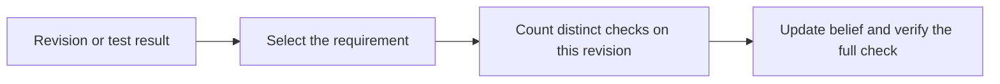
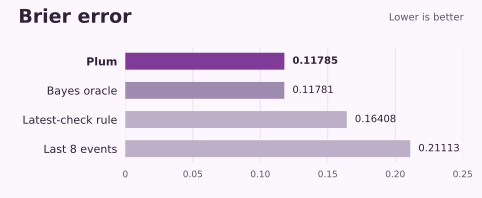

# Plum · The Belief Lab

A coding agent can finish with green checks after an earlier regression has slipped out of view. Plum tracks structured check evidence by requirement and revision. It keeps a learned 660-parameter GRU alongside an evidence posterior and a separate verification rule.

In the original GRU experiment, both Click runs ended with the same passing checks. The GRU gave the original regression test a **24.8%** chance of passing before the upstream fix and **96.5%** after. [Test output](submission/Plum-Click-Test.txt)

**[Try the live demo](https://plum-sbm-demo.vercel.app/)** · [PyTorch model](referee.py) · [Method and reproduction](METHOD.md)

## Try it

The Python package includes the trained weights and runs offline on Python 3.10 or newer.

```sh
pip install ./python_package
plum demo
```

```python
from plum_sbm import Plum

plum = Plum()
plum.feed("revision", "regression")
plum.feed("strong_fail", "regression", evidence_id="original-test")
for _ in range(10):
    plum.feed("noise")
print(f"{plum.query('regression'):.0%}")  # 10%

plum.feed("revision", "regression")
plum.feed("strong_pass", "regression", evidence_id="original-test")
print(f"{plum.query('regression'):.0%}")  # 90%
assert plum.ready("regression")
```

## How it works



**48 state values** · `[ Regression ×12 | Build ×12 | Integration ×12 | Style ×12 ]`

The four vectors share one GRU for the learned comparison. The evidence score adds log odds for distinct checks. A revision clears its channel and resets the score to 50%. A full failure blocks readiness for that revision. Readiness requires an identified full pass and a score of at least 85%.

Use the same `evidence_id` for copies of the same observation. The test runner supplies revision attribution and reliability. The default rates are 90% for full checks and 75% for spot checks. Use `learned_query()` to read the original GRU score. [Python API](python_package/README.md)

The Avadhanam-inspired training streams interleave checks from all four requirements with distractors. A Bayesian simulator supplies a target probability at each step, so the model learns how to combine evidence throughout the stream.

## What it measured



The held-out simulation used 256 streams of 192 events with 75% distractors. The Bayes oracle uses the simulator's exact reliability rates of 90% for full checks and 75% for spot checks.

**Recorded Django run.** After the agent changed the failing test, Plum held at **10%** and the eight-event model reached **50%**. The benchmark marked the run unresolved. We mapped the trace to typed events by hand. [Replay and event mapping](REAL_TRACE.md)
