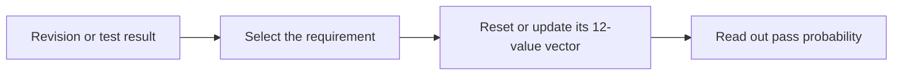

# Plum · The Belief Lab

Plum is a **660-parameter stateful model** that tracks test evidence across a coding agent's run. It reads typed events once and estimates whether the original requirement passes.

**[Try the live demo](https://plum-sbm-demo.vercel.app/)** · [PyTorch model](referee.py) · [Method and reproduction](METHOD.md)

```sh
pip install plum-sbm
plum demo
```

## How it works



**48 state values** · `[ Regression ×12 | Build ×12 | Integration ×12 | Style ×12 ]`

The four vectors share one GRU. A revision clears its vector and resets its probability to 50%. Outdated results leave state unchanged.

## What it measured


Held-out simulation with 256 streams, 192 events per stream, and 75% distractors. The oracle knows the simulator's test reliability.

- **Click regression.** The original test failed before the upstream fix and passed after it. Plum scored **24.8% → 96.5%** across two runs with identical trailing evidence. [Test output](submission/Plum-Click-Test.txt)
- **Recorded Django run.** After the agent changed the failing test, Plum held at **10%** and the eight-event model reached **50%**. The benchmark marked the run unresolved. [Replay and event mapping](REAL_TRACE.md)
