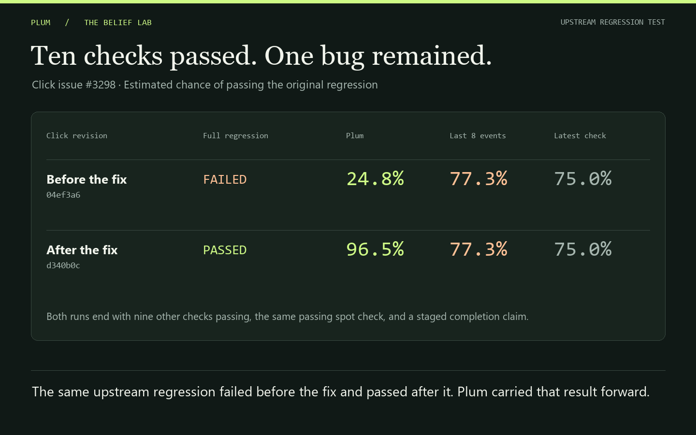

# Plum · An Avadhanam-inspired agent referee

**Ten checks passed. One regression was still broken.** We ran [Click’s own regression test](https://github.com/pallets/click/pull/3299/files) before and after the maintainer’s fix. It failed before the fix and passed after it, even though both runs ended with the same ten passing checks.

**At the staged completion claim, Plum gave the original regression a 24.8% chance of passing before the fix and a 96.5% chance after it.** Both baselines gave identical scores across the two revisions. [See the actual pytest output](https://github.com/RABNEER/Plum/blob/main/submission/Plum-Click-Test.txt)



Plum is an Avadhanam-inspired stateful model that tracks test evidence and flags when a coding agent’s completion claim needs another check.

[Try the live Plum demo](https://plum-sbm-demo.vercel.app/) · [Install from PyPI](https://pypi.org/project/plum-sbm/)

Run `pip install plum-sbm` and then `plum demo` to try the bundled model offline.

## Why it matters

In a recorded SWE-bench Verified run, a coding agent saw a Django regression test fail, changed the assertion, then submitted its patch after the edited test passed. The benchmark marked the run unresolved. In our hand-mapped replay, **Plum gave the original check a 10% chance of passing**, versus **50%** for the model that saw only the last eight events. [Trace source and mapping](https://github.com/RABNEER/Plum/blob/main/REAL_TRACE.md)

## What we built

Plum is a stateful belief model with 660 learned parameters and 48 values of recurrent state. It reads each structured event once and outputs a probability for each of four requirements. In the browser, you can step through the recorded trace or send your own checks and distractions in the simulator. Inference runs on the device.

The simulated recovery lets you watch Plum return to 50% when a new revision starts, then raise its probability as fresh checks pass. Each requirement has its own state. You can send a Regression check and see that the Build belief stays where it was.

## How we built it

Avadhanam inspired the training setup. We interleave four lines of evidence, add distractions, and ask about each requirement after intervening activity. In the simulator, full checks report the latent outcome correctly 90% of the time and spot checks do so 75% of the time. We trained a shared PyTorch GRU cell and an eight-event MLP on the simulator’s exact posterior probabilities. Plum keeps separate state for each requirement. A new revision resets its own requirement to 50%. The browser runs the exported weights in JavaScript.

## What we measured

On 256 held-out streams of 192 events with 75% distractors, Plum reached a Brier score of **0.11785**, compared with **0.21113** for the eight-event MLP, **0.16408** for a rule that remembers only the most recent check per requirement, and **0.11781** for the exact Bayes oracle. Lower is better. Where the last relevant event was at least eight events old, the mean squared error versus the oracle was **0.000012** for Plum and **0.144503** for the MLP.

The benchmark uses synthetic evidence and known check reliability. The recorded trace is a hand-reviewed selection of one public run. Its benchmark outcome is shown after the replay and is kept out of the model input. The replay illustrates what the model can do with structured evidence. A broader test on real logs would need labeled traces and a way to measure how well raw events are mapped.

## Submission assets

- Interactive demo: use the [public Vercel link](https://plum-sbm-demo.vercel.app/).
- Source: [Plum on GitHub](https://github.com/RABNEER/Plum).
- Video: upload the local `Plum-Submission.mp4`, the 2:06 narrated demo with captions, to a video host accepted by the event. Paste the hosted video URL into Devpost. The [script and shot plan](PLUM_VIDEO_SCRIPT.md) list the evidence shown in each scene. [Devpost video instructions](https://help.devpost.com/article/85-uploading-a-demo-video)
- Video thumbnail: use `submission/Plum-Submission-Cover.png`.
- Images: lead with the Click comparison and include the recorded replay as an interface example.
- Add your Devpost team and author details, then verify all links signed out.

## Hosted video description

```text
Try Plum in your browser: https://plum-sbm-demo.vercel.app/

Step through a recorded Django agent run, then send your own test evidence to see how Plum updates its belief.
```
